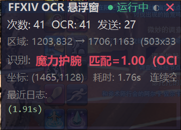
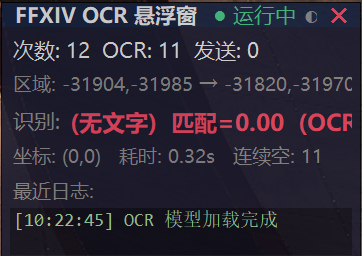

# FF14 Keybound Brawler Bot

> FFXIV Keybound Brawler event helper -- OCR screen text recognition, fuzzy wordlist matching, automatic input and send.

A small Python tool for the FFXIV Keybound Brawler event. It reads enemy overhead text via OCR, matches it against a wordlist, types it into the chat input, and presses Enter to send -- all in a loop.

## Screenshots

Ready | Detecting and Sending
:---: | :---:
 | 

## How it works

```
Grab game window screenshot
  -> RapidOCR recognizes enemy overhead text (Chinese + punctuation)
  -> Fuzzy match against 1210-entry FFXIV wordlist
  -> Press Enter (scan code 0x1C) to open chat input
  -> SendInput KEYEVENTF_UNICODE to inject characters
  -> Press Enter again to send
  -> Loop
```

## Quick start

### 1. Install dependencies

```powershell
pip install -r requirements.txt
```

### 2. Run as Administrator (required)

FFXIV runs with Administrator privileges. Windows UIPI (User Interface Privilege Isolation) silently drops SendInput calls from lower-integrity processes. If you run Python without admin, the program will appear to work but nothing happens in-game.

**Right-click `run_admin.bat` -> Run as Administrator**

Or from an elevated PowerShell / CMD:

```powershell
python main.py --autostart
```

### 3. In the Keybound Brawler duty

- **Alt+V** -- start the auto loop
- **Shift+V** -- stop
- **F8** -- toggle overlay transparency

That's it. It keeps recognizing and sending until you stop it.

## CLI options

```powershell
# Custom interval and iteration limit
python main.py --autostart --interval 2.0 --max-iterations 30

# Manually specify the OCR region (left top right bottom)
python main.py --region 600 400 1300 750

# Custom window title keyword
python main.py --window-title "FFXIV"
```

| Option | Default | Description |
|---|---|---|
| `--region` | auto | OCR region `left top right bottom` |
| `--window-title` | `最终幻想XIV` | Game window title keyword |
| `--center-ratio` | `0.3` | Screen center area ratio for OCR |
| `--interval` | `0.0` | Loop interval in seconds |
| `--pause-between` | `0.08` | Pause between Enter / text / Enter |
| `--max-iterations` | `0` (unlimited) | Max loop iterations |
| `--autostart` | `False` | Auto-start the loop on launch |

## Project structure

```
FF14-Keybound-Brawler-Bot/
├── main.py              # Floating overlay + OCR + matching + input loop
├── win_driver.py        # Interception driver-level injection wrapper
├── win_keys.py          # SendInput fallback implementation
├── words.txt            # 1210 FFXIV-specific vocabulary entries
├── requirements.txt     # Python dependencies
├── run_admin.bat        # One-click admin launcher
├── diag_admin.bat       # Admin diagnostic script
├── docs/
│   ├── TECHNICAL.md         # Architecture, APIs, design notes
│   ├── screenshot_ready.png
│   └── screenshot_sending.png
└── README.md
```

## Caveats

- **Admin required** -- non-admin run = SendInput silently dropped by UIPI = nothing happens in-game
- **Windowed / Borderless** -- Fullscreen exclusive mode may fail to capture screenshots. Windowed maximized is recommended.
- **No Chinese IME needed** -- SendInput KEYEVENTF_UNICODE injects raw Unicode code points directly, bypassing the IME entirely.

## Technical details

Interception driver injection, SendInput ctypes struct alignment, UIPI mechanics, OCR pipeline, and a full pitfall log:

> [docs/TECHNICAL.md](docs/TECHNICAL.md)

## License

MIT
